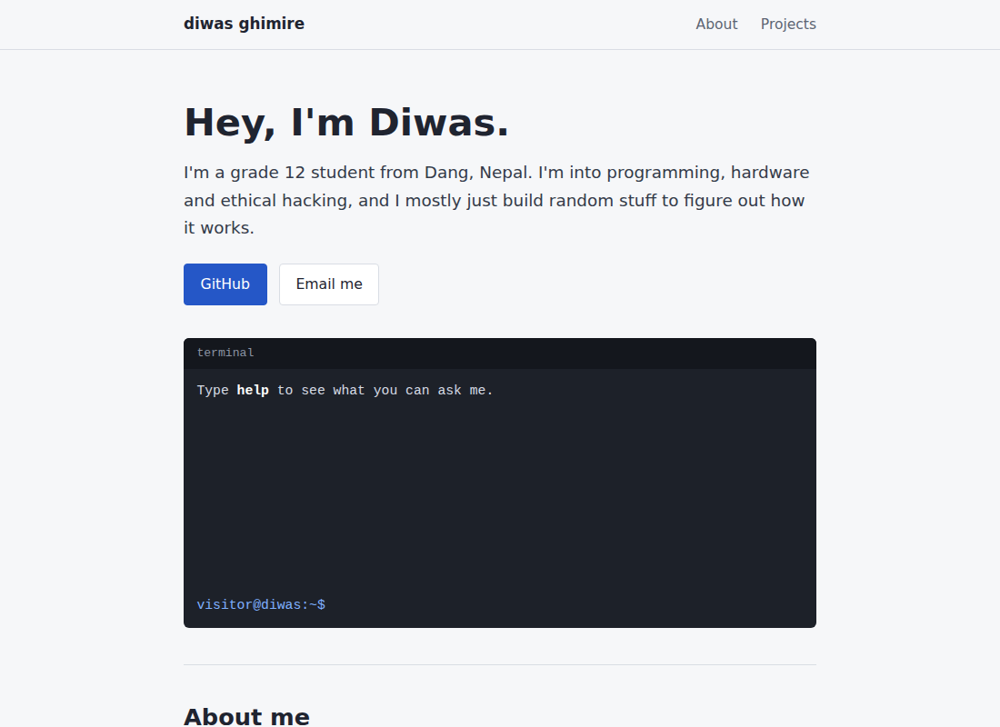
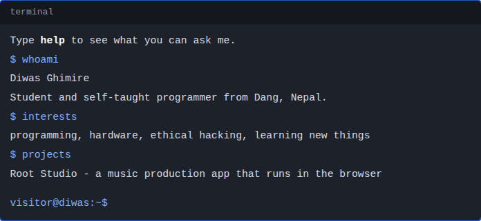
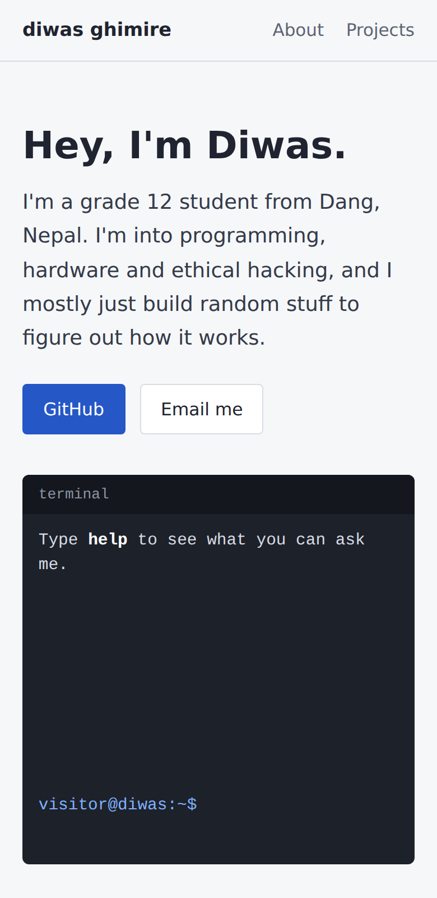

# Diwas Ghimire - personal website

This is my personal website. It's got a quick intro about me, the stuff I'm into, what I've built, and how to reach me.

## What's on it

- **Home** - short intro and a little terminal you can actually type in
- **About** - who I am and what I'm into
- **Projects** - things I've made

## The terminal

Click on it and type stuff like `help`, `whoami`, `interests`, `projects`, `github` or `clear`. Up arrow brings back your old commands.

## It works on phones too

## Files

- `index.html` - the page itself
- `style.css` - how it looks
- `script.js` - makes the terminal work
- `screenshots/` - the pictures in this readme
- `progress/` - the site stage by stage, from the first basic page to the finished one

## How I made it

Only plain HTML, CSS and JavaScript. No frameworks, because I wanted to keep it simple and actually understand all of it.
